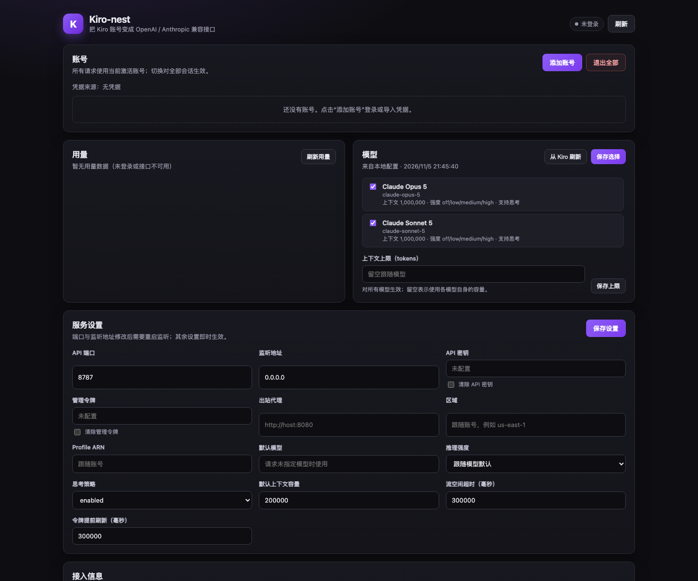

# Kiro-nest

English | [中文](README.zh.md)

A standalone HTTP gateway that turns Kiro accounts into OpenAI- and Anthropic-compatible endpoints. It ships with a web settings page and supports multi-account login, live model discovery, usage reporting, reasoning effort, images, tool calls, and streaming. Run it with Docker or plain Node.



*The settings page on first launch, before any account is added.*

This project is derived from the Kiro protocol core of `dsh-kiro` and now keeps only the standalone gateway. It is an independent integration and is not affiliated with or endorsed by AWS or Kiro. Kiro and its logo are Amazon trademarks; see [NOTICE.md](NOTICE.md).

## Features

- **Two protocols**: OpenAI Chat Completions and Anthropic Messages, both streaming and non-streaming.
- **Multiple accounts**: Builder ID, IAM Identity Center, Google, and GitHub device login, plus refresh-token, Kiro API key, and Microsoft external-IdP imports.
- **Account management**: add, switch, and remove accounts from the page; requests use the active account.
- **Model discovery**: fetch the account's live catalog after login, refresh manually, and enable or disable models.
- **Usage**: plan, credits used, remaining percentage, and reset dates.
- **Reasoning controls**: map `reasoning_effort` / Anthropic `thinking` onto Kiro's native effort field.
- **Images and tools**: base64 image input, OpenAI tools, and Anthropic `tool_use` / `tool_result`.
- **Outbound proxy**: HTTP/HTTPS `CONNECT`, including authenticated proxy URLs.
- **Page configuration**: port, bind address, API/admin keys, proxy, region, profile ARN, default model, context ceiling, and more.
- **Simple deployment**: one Node process; the Docker image needs no `node_modules`.

## Quick start

### Docker

```sh
docker compose up -d --build
```

Open <http://localhost:8787/> and sign in to a Kiro account.

Accounts, configuration, and model selection live under `/data` in the `kiro-nest-data` volume. Set access keys in `docker-compose.yml` or through the environment for a first deployment:

```yaml
environment:
  KIRO_NEST_API_KEY: "change-me"
  KIRO_NEST_ADMIN_TOKEN: "change-me-too"
```

### Run directly

```sh
npm install
npm run build
KIRO_NEST_DATA_DIR=./data npm run gateway:start
```

For development, run the TypeScript sources directly (Node 24 native type stripping):

```sh
npm run gateway
# restart on changes
npm run gateway:dev
```

### Open the page

The default address is <http://localhost:8787/>. The page exposes accounts, usage, models, service settings, and client connection details.

## Configuration

Configuration is read per request, so proxy, region, and default-model changes apply immediately. Port and bind-address changes require a listener restart; the page offers a restart button.

### Environment variables

Environment variables take precedence over the config file. They are the recommended way to configure containers.

| Variable | Default | Description |
| --- | --- | --- |
| `KIRO_NEST_PORT` / `PORT` | `8787` | HTTP listen port |
| `KIRO_NEST_HOST` | `0.0.0.0` | Listen address; use `127.0.0.1` for local-only access |
| `KIRO_NEST_DATA_DIR` / `DATA_DIR` | `./data` | Data directory |
| `KIRO_NEST_API_KEY` | empty | Model API key; empty disables authentication |
| `KIRO_NEST_ADMIN_TOKEN` | empty | Page and `/api/*` admin token; empty disables authentication |
| `KIRO_NEST_PROXY_URL` / `KIRO_PROXY_URL` | empty | Outbound HTTP/HTTPS proxy |
| `KIRO_NEST_REGION` / `KIRO_REGION` | account value | Force an AWS region |
| `KIRO_NEST_PROFILE_ARN` | account value | Force a CodeWhisperer profile |
| `KIRO_NEST_DEFAULT_MODEL` | empty | Model used when a request names none; empty picks the first catalog entry |
| `KIRO_NEST_REASONING_EFFORT` | model default | Override reasoning effort for every model |
| `KIRO_NEST_THINKING` | `enabled` | `enabled` or `disabled` |
| `KIRO_NEST_MAX_CONTEXT_WINDOW` | unset | Global context ceiling |
| `KIRO_NEST_DEFAULT_CONTEXT_WINDOW` | `200000` | Fallback capacity when a model reports no exact value |
| `KIRO_NEST_STREAM_IDLE_TIMEOUT_MS` | `300000` | Maximum idle time for one stream read |
| `KIRO_NEST_TOKEN_EXPIRY_BUFFER_MS` | `300000` | How early to refresh access tokens |

### Page fields

The page can change most of the settings above and also shows the data directory and whether keys are configured. Leaving a key input empty keeps the current value; use the clear checkbox to delete it.

### Ports and containers

- Changing the port in the page only moves the process listener; it does not change Docker port mapping.
- For containers, prefer `KIRO_NEST_PORT` and keep the compose `ports` mapping in sync.
- The default is the named `kiro-nest-data` volume. If you switch to a host directory (for example `./data:/data`), make sure it is writable by uid `1000` inside the container.

## Client setup

### OpenAI

Base URL: `http://localhost:8787/v1`

```sh
curl http://localhost:8787/v1/models

curl http://localhost:8787/v1/chat/completions \
  -H 'content-type: application/json' \
  -H 'authorization: Bearer <KIRO_NEST_API_KEY>' \
  -d '{
    "model": "claude-sonnet-5",
    "messages": [{"role": "user", "content": "hello"}],
    "stream": true
  }'
```

Supported fields:

- `model`, `messages`, `stream`, `stream_options.include_usage`
- `max_tokens` / `max_completion_tokens`
- `reasoning_effort`
- `tools` / `tool_choice` (tool definitions and tool results)
- `stop`, `user` (`user` becomes a stable session id)
- Images: `image_url` or `input_image` content parts, base64 `data:` URLs only

### Anthropic

Base URL: `http://localhost:8787/anthropic`

```sh
curl http://localhost:8787/anthropic/v1/messages \
  -H 'content-type: application/json' \
  -H 'x-api-key: <KIRO_NEST_API_KEY>' \
  -d '{
    "model": "claude-sonnet-5",
    "max_tokens": 1024,
    "messages": [{"role": "user", "content": "hello"}],
    "stream": true
  }'
```

The gateway also accepts `POST /v1/messages` at the root, so Claude Code can point `ANTHROPIC_BASE_URL` at the gateway root:

```sh
export ANTHROPIC_BASE_URL=http://localhost:8787
export ANTHROPIC_AUTH_TOKEN=<KIRO_NEST_API_KEY>
```

### Authentication

- With `KIRO_NEST_API_KEY` set, model endpoints require `Authorization: Bearer <key>` or `x-api-key: <key>`.
- With `KIRO_NEST_ADMIN_TOKEN` set, `/api/*` requires `Authorization: Bearer <token>`, `x-admin-token: <token>`, or `?token=<token>`.
- The two keys are independent: a model key cannot access the management API.

## Accounts and login

On the page, click **Add account** and choose a method:

- **AWS Builder ID / IAM Identity Center**: standard device authorization; IDC needs a Start URL.
- **Google / GitHub**: Kiro's social device flow; the page shows the verification URL and a one-time user code.
- **Refresh token**: import an existing Kiro refresh token, with optional region, client id/secret, and profile ARN.
- **Kiro API key**: imported and verified against the account model catalog.
- **Microsoft external IdP**: import a CLIProxyAPI-compatible credential JSON.

After login, the gateway:

1. saves the credential and makes it the active account;
2. tries to discover the profile ARN;
3. refreshes the account's model catalog in the background.

Credentials live in `<dataDir>/storages/kiro-auth` with `0600` file permissions and `0700` directories. When no gateway-managed account exists, the gateway falls back to Kiro IDE/CLI credentials in `~/.aws/sso/cache/kiro-auth-token.json`.

### Migrating from the old dsh-kiro

The gateway keeps the same directory layout. Copy an existing `~/.dsh/storages/kiro-auth` into `<dataDir>/storages/kiro-auth`; the page will recognize it as gateway-managed accounts.

## Models

Before login, or when discovery fails, the built-in placeholder catalog contains only two primary models:

- `claude-sonnet-5`
- `claude-opus-5`

After login, the page shows the account's live catalog and enables newly discovered models automatically. The enabled list can be edited on the page; `/v1/models` and the model selector then expose only enabled models.

Each live catalog entry carries context capacity, output limits, input modalities, reasoning-effort values, and defaults. The page's context ceiling is applied as an upper bound for every model.

Reasoning effort maps from OpenAI `reasoning_effort` or Anthropic `thinking.budget_tokens`:

- Anthropic `thinking: { type: "disabled" }` → `off`
- budget ≤ 4000 → `low`
- budget ≤ 12000 → `medium`
- larger budget → `high`
- OpenAI `reasoning_effort` is used directly

## Usage

The page shows the Kiro plan, credits used, remaining percentage, and reset dates. Usage is cached for five minutes and can be refreshed manually. A failing quota endpoint never affects chat or clears the last successful result.

## Protocol behavior

### System prompt

Kiro's `generateAssistantResponse` has no dedicated system slot, so system content is merged into the earliest user turn. OpenAI `system`/`developer` messages and the Anthropic `system` field all land there.

### Tool calls

- OpenAI: `tools[].function` becomes a Kiro tool schema; assistant `tool_calls` and `tool` messages become Kiro tool calls/results.
- Anthropic: `tools[].input_schema`, `tool_use`, and `tool_result` map directly; tool results in the same user message are sent first as tool turns.
- Tool names must match `^[A-Za-z][A-Za-z0-9_]{0,63}$`.

### Images

The gateway accepts base64 `data:` URLs only:

- OpenAI: `image_url.url` / `input_image.image_url`
- Anthropic: `{ "type": "image", "source": { "type": "base64", "media_type": "...", "data": "..." } }`

png, jpeg, gif, and webp are supported. The gateway never fetches remote image URLs, which avoids SSRF; a remote URL returns 400. Kiro accepts images only on user turns, so images in assistant history are rejected rather than silently dropped.

### Streaming

- OpenAI: `data: {...}` frames ending with `data: [DONE]`; enabling `stream_options.include_usage` adds a usage frame.
- Anthropic: the full `message_start` → `content_block_start` → `content_block_delta` → `content_block_stop` → `message_delta` → `message_stop` sequence.
- Reasoning is exposed as `reasoning_content` for OpenAI and as `thinking` blocks for Anthropic.

### Ignored parameters

Kiro's `generateAssistantResponse` has no place for sampling controls, so `temperature`, `top_p`, and `top_k` are ignored. `stop` is parsed by the gateway but has no upstream field and does not take effect.

## Errors

| Condition | HTTP status |
| --- | --- |
| Malformed request, unknown role, context overflow | 400 |
| Model API unauthorized | 401 |
| Quota exhausted | 402 |
| Unknown model | 404 |
| Request body too large | 413 |
| Rate limited | 429 |
| Upstream credential or service failure | 502 |
| Upstream timeout | 504 |
| Client aborted | 499 |

Error bodies follow the client protocol: `{ "error": { ... } }` for OpenAI and `{ "type": "error", "error": { ... } }` for Anthropic.

## Security

- Credential files are `0600` and the data directory is `0700`; the page reports whether keys are configured but never returns their values.
- Public deployments must set `KIRO_NEST_API_KEY` and `KIRO_NEST_ADMIN_TOKEN`, ideally behind an HTTPS reverse proxy.
- Images must be base64 data URLs; the gateway does not fetch remote URLs.
- The admin token and model key are independent.
- Logs and error messages redact bearer tokens and refresh tokens.

## Development and testing

```sh
npm install
npm run gateway:dev   # TypeScript sources with watch mode
npm test              # Vitest
npm run check         # typecheck + tests + build + artifact syntax check
npm run build         # tsc + tsdown, outputs lib/gateway/main.js
npm run pack:dist     # build an npm package
```

The tests cover:

- configuration merging, authentication, and static-file routing
- OpenAI/Anthropic request translation and SSE encoding
- end-to-end streaming and non-streaming HTTP completions
- account storage, login, credential parsing, model discovery, usage parsing, and Amazon EventStream decoding

The current suite does not call a real Kiro account.

## Known limitations

- Anthropic thinking blocks omit `signature_delta`; clients that strictly validate extended-thinking signatures may need additional adaptation.
- `temperature`, `top_p`, `top_k`, and `stop` are not honored upstream.
- Images are limited to base64 data URLs; remote URLs are never fetched.
- SOCKS proxies are not supported.
- Before login, only two placeholder models are shown; the live catalog takes over after authentication.
- Changing the port from the page inside a container requires updating the Docker port mapping as well.

## Acknowledgements

The Kiro transport and protocol implementation is derived from [dat-lequoc/dsh-kiro](https://github.com/dat-lequoc/dsh-kiro), whose transport foundation came from [caopu16/dsh-llm-kiro](https://github.com/caopu16/dsh-llm-kiro) under the MIT license. Login, profile ARN, API key, and external-IdP behavior were checked against [decolua/9router](https://github.com/decolua/9router) and [dat-lequoc/Kiro-Go](https://github.com/dat-lequoc/Kiro-Go). Original copyright notices are retained in [LICENSE](LICENSE).

## License

MIT
