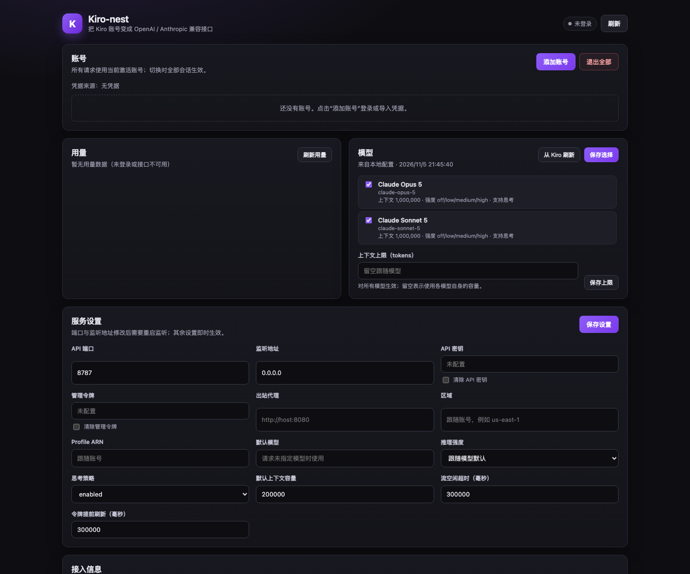

# Kiro-nest

[English](README.md) | 中文

把 Kiro 账号变成 OpenAI / Anthropic 兼容接口的独立 HTTP 网关。自带配置页面，支持多账号登录、实时模型发现、用量查询、推理强度、图片、工具调用与流式响应，可用 Docker 或 Node 直接部署。



*首次启动时的配置页面（尚未添加账号）。*

本项目源自 `dsh-kiro` 的 Kiro 协议核心，现在只保留独立网关形态，不再提供 DeepSeek Harness 插件。与 AWS 或 Kiro 没有关联，也未获其赞助或认可；Kiro 及其徽标是 Amazon 的商标，详见 [NOTICE.md](NOTICE.md)。

## 功能

- **双协议端点**：OpenAI Chat Completions 与 Anthropic Messages，均支持流式和非流式。
- **多账号**：Builder ID、IAM Identity Center、Google、GitHub 设备码登录，以及 refresh token、Kiro API key、Microsoft external-IdP 凭据导入。
- **账号管理**：页面添加、切换、移除账号；请求使用当前激活账号。
- **模型发现**：登录后自动拉取账号实时模型目录，也可在页面手动刷新；支持启用/禁用模型。
- **用量查询**：展示套餐、credits 使用量、剩余比例与重置时间。
- **推理控制**：`reasoning_effort` / Anthropic `thinking` 映射到 Kiro 原生 effort 字段。
- **图片与工具**：base64 图片输入、OpenAI tools 与 Anthropic tool_use/tool_result。
- **出站代理**：HTTP/HTTPS `CONNECT` 代理，支持带认证的代理 URL。
- **页面配置**：端口、监听地址、API/管理密钥、代理、区域、profile ARN、默认模型、上下文上限等。
- **部署简单**：单个 Node 进程；Docker 镜像不依赖 `node_modules`。

## 快速开始

### Docker

```sh
docker compose up -d --build
```

打开 <http://localhost:8787/>，在页面中登录 Kiro 账号。

账号、配置与模型选择保存在 `kiro-nest-data` 卷的 `/data` 下。首次部署建议在 `docker-compose.yml` 或环境变量中设置访问密钥：

```yaml
environment:
  KIRO_NEST_API_KEY: "change-me"
  KIRO_NEST_ADMIN_TOKEN: "change-me-too"
```

### 直接运行

```sh
npm install
npm run build
KIRO_NEST_DATA_DIR=./data npm run gateway:start
```

开发时可以直接运行 TypeScript 源码（Node 24 原生类型剥离）：

```sh
npm run gateway
# 或监听改动自动重启
npm run gateway:dev
```

### 打开页面

默认地址为 <http://localhost:8787/>。页面提供账号、用量、模型、服务设置与接入信息。

## 配置

配置按请求读取，修改代理、区域、默认模型等立即生效；端口与监听地址的修改需要重启监听，页面会提示并提供“重启监听”按钮。

### 环境变量

环境变量优先于配置文件；容器部署建议用环境变量。

| 变量 | 默认值 | 说明 |
| --- | --- | --- |
| `KIRO_NEST_PORT` / `PORT` | `8787` | HTTP 监听端口 |
| `KIRO_NEST_HOST` | `0.0.0.0` | 监听地址；仅本机使用可设为 `127.0.0.1` |
| `KIRO_NEST_DATA_DIR` / `DATA_DIR` | `./data` | 数据目录 |
| `KIRO_NEST_API_KEY` | 空 | 模型 API 密钥；空表示不鉴权 |
| `KIRO_NEST_ADMIN_TOKEN` | 空 | 页面与 `/api/*` 的管理令牌；空表示不鉴权 |
| `KIRO_NEST_PROXY_URL` / `KIRO_PROXY_URL` | 空 | 出站 HTTP/HTTPS 代理 |
| `KIRO_NEST_REGION` / `KIRO_REGION` | 跟随账号 | 强制 AWS 区域 |
| `KIRO_NEST_PROFILE_ARN` | 跟随账号 | 强制 CodeWhisperer profile |
| `KIRO_NEST_DEFAULT_MODEL` | 空 | 请求未指定模型时使用；空则取目录第一个 |
| `KIRO_NEST_REASONING_EFFORT` | 跟随模型 | 覆盖所有模型的推理强度 |
| `KIRO_NEST_THINKING` | `enabled` | `enabled` 或 `disabled` |
| `KIRO_NEST_MAX_CONTEXT_WINDOW` | 未设置 | 全局上下文上限 |
| `KIRO_NEST_DEFAULT_CONTEXT_WINDOW` | `200000` | 模型未提供精确容量时的后备值 |
| `KIRO_NEST_STREAM_IDLE_TIMEOUT_MS` | `300000` | 单次流式读取的最大空闲时间 |
| `KIRO_NEST_TOKEN_EXPIRY_BUFFER_MS` | `300000` | 提前刷新 access token 的时间窗口 |

### 页面字段

页面可以修改上述大部分设置，并额外显示数据目录与密钥是否已配置。密钥输入框留空表示保持不变，勾选“清除”才会删除。

### 端口与容器

- 页面修改端口只改变进程监听地址，不会改变 Docker 端口映射。
- 容器部署时优先通过 `KIRO_NEST_PORT` 与环境变量调整端口，并同步修改 `docker-compose.yml` 的 `ports`。
- 默认使用命名卷 `kiro-nest-data`；若改为宿主机目录挂载（例如 `./data:/data`），请确保目录对容器内 uid `1000` 可写。

## 客户端接入

### OpenAI

Base URL：`http://localhost:8787/v1`

```sh
curl http://localhost:8787/v1/models

curl http://localhost:8787/v1/chat/completions \
  -H 'content-type: application/json' \
  -H 'authorization: Bearer <KIRO_NEST_API_KEY>' \
  -d '{
    "model": "claude-sonnet-5",
    "messages": [{"role": "user", "content": "你好"}],
    "stream": true
  }'
```

支持字段：

- `model`、`messages`、`stream`、`stream_options.include_usage`
- `max_tokens` / `max_completion_tokens`
- `reasoning_effort`
- `tools` / `tool_choice`（工具声明与工具结果）
- `stop`、`user`（`user` 作为稳定会话标识）
- 图片：`content` 数组中的 `image_url` 或 `input_image`，仅接受 base64 `data:` URL

### Anthropic

Base URL：`http://localhost:8787/anthropic`

```sh
curl http://localhost:8787/anthropic/v1/messages \
  -H 'content-type: application/json' \
  -H 'x-api-key: <KIRO_NEST_API_KEY>' \
  -d '{
    "model": "claude-sonnet-5",
    "max_tokens": 1024,
    "messages": [{"role": "user", "content": "你好"}],
    "stream": true
  }'
```

同时接受根路径 `POST /v1/messages`，方便 Claude Code 直接把 `ANTHROPIC_BASE_URL` 指向网关根地址：

```sh
export ANTHROPIC_BASE_URL=http://localhost:8787
export ANTHROPIC_AUTH_TOKEN=<KIRO_NEST_API_KEY>
```

### 鉴权

- 设置了 `KIRO_NEST_API_KEY` 时，模型端点需要 `Authorization: Bearer <key>` 或 `x-api-key: <key>`。
- 设置了 `KIRO_NEST_ADMIN_TOKEN` 时，`/api/*` 需要 `Authorization: Bearer <token>`、`x-admin-token: <token>` 或 `?token=<token>`。
- 两个密钥相互独立：模型密钥不能访问管理 API。

## 账号与登录

在页面点击“添加账号”，选择登录方式：

- **AWS Builder ID / IAM Identity Center**：标准设备码授权；IDC 需要填写 Start URL。
- **Google / GitHub**：Kiro 的社交设备流程，页面显示验证地址与一次性用户码。
- **刷新令牌**：导入已有 Kiro refresh token，可指定区域、client id/secret、profile ARN。
- **Kiro API Key**：导入后立即与账号模型目录校验。
- **Microsoft External IdP**：导入兼容 CLIProxyAPI 的凭据 JSON。

登录完成后，网关会：

1. 保存凭据并设为当前账号；
2. 尝试发现 profile ARN；
3. 在后台刷新该账号的模型目录。

凭据存放在 `<dataDir>/storages/kiro-auth`，文件权限 `0600`，目录权限 `0700`。若没有网关管理的账号，会回退读取本机 Kiro IDE/CLI 的 `~/.aws/sso/cache/kiro-auth-token.json`。

### 从旧版 dsh-kiro 迁移

网关沿用与 `dsh-kiro` 相同的目录结构。把旧的 `~/.dsh/storages/kiro-auth` 复制到 `<dataDir>/storages/kiro-auth`，页面会把它识别为网关管理的账号。

## 模型

未登录或模型发现失败时，使用内置占位目录，只保留两个主力模型：

- `claude-sonnet-5`
- `claude-opus-5`

登录后页面会显示该账号实际可用的完整模型目录，并自动启用新发现的模型。页面可调整启用列表；保存后，`/v1/models` 与模型选择器只展示启用的模型。

每个模型的实时目录会携带上下文容量、输出上限、支持的输入模态、reasoning effort 枚举与默认值。页面“上下文上限”会对所有模型取较小值，用于限制上报容量。

推理强度通过 OpenAI `reasoning_effort` 或 Anthropic `thinking.budget_tokens` 映射：

- Anthropic `thinking: { type: "disabled" }` → `off`
- 预算 ≤ 4000 → `low`
- 预算 ≤ 12000 → `medium`
- 更大预算 → `high`
- OpenAI `reasoning_effort` 直接使用对应档位

## 用量

页面展示 Kiro 套餐、credits 使用量、剩余比例和重置日期。用量缓存五分钟，可点击“刷新用量”强制更新。额度接口失败不会影响聊天，也不会清除上次成功结果。

## 协议行为

### system prompt

Kiro 的 `generateAssistantResponse` 没有独立 system 槽位，system 内容会被合并到最早的 user 轮次。OpenAI 的 `system`/`developer` 消息与 Anthropic 的 `system` 字段都会进入这个位置。

### 工具调用

- OpenAI：`tools[].function` 转换为 Kiro 工具 schema；assistant `tool_calls` 与 `tool` 消息转换为 Kiro 的工具调用/结果。
- Anthropic：`tools[].input_schema`、`tool_use`、`tool_result` 直接映射；同一 user 消息中的工具结果会先作为 tool 轮次发送。
- 工具名必须匹配 `^[A-Za-z][A-Za-z0-9_]{0,63}$`。

### 图片

网关只接受 base64 `data:` URL：

- OpenAI：`image_url.url` / `input_image.image_url`
- Anthropic：`{ "type": "image", "source": { "type": "base64", "media_type": "...", "data": "..." } }`

支持 png、jpeg、gif、webp。网关不会主动抓取远程图片 URL，避免 SSRF；远程 URL 会返回 400。Kiro 只在 user 轮次接受图片，assistant 历史中的图片会被拒绝。

### 流式

- OpenAI：`data: {...}` 帧，结束发送 `data: [DONE]`；开启 `stream_options.include_usage` 时额外发送 usage 帧。
- Anthropic：完整的 `message_start` → `content_block_start` → `content_block_delta` → `content_block_stop` → `message_delta` → `message_stop` 事件序列。
- 推理内容在 OpenAI 中以 `reasoning_content` 返回，在 Anthropic 中以 `thinking` 块返回。

### 忽略的参数

Kiro 的 `generateAssistantResponse` 不提供采样参数位置，以下字段会被忽略：`temperature`、`top_p`、`top_k`。`stop` 虽然会被网关解析，但上游协议没有对应字段，实际不会生效。

## 错误

| 情况 | HTTP 状态 |
| --- | --- |
| 请求格式错误、未知角色、上下文超限 | 400 |
| 模型 API 未授权 | 401 |
| 套餐额度耗尽 | 402 |
| 模型不存在 | 404 |
| 请求体过大 | 413 |
| 速率限制 | 429 |
| 上游凭据/服务错误 | 502 |
| 上游超时 | 504 |
| 客户端中断 | 499 |

错误体按客户端协议返回：OpenAI 为 `{ "error": { ... } }`，Anthropic 为 `{ "type": "error", "error": { ... } }`。

## 安全

- 凭据文件 `0600`，数据目录 `0700`；页面只报告密钥是否已配置，不返回密钥原文。
- 公网部署必须设置 `KIRO_NEST_API_KEY` 与 `KIRO_NEST_ADMIN_TOKEN`，并建议置于 HTTPS 反向代理之后。
- 图片只接受 base64 data URL，网关不代客户端访问远程 URL。
- 管理令牌与模型密钥相互独立。
- 日志与错误信息会脱敏 bearer token 与 refresh token。

## 开发与测试

```sh
npm install
npm run gateway:dev   # 源码直跑并 watch
npm test              # Vitest
npm run check         # 类型检查 + 测试 + 构建 + 产物语法检查
npm run build         # tsc + tsdown，输出 lib/gateway/main.js
npm run pack:dist     # 生成 npm 包
```

测试覆盖：

- 配置合并、鉴权与静态文件路由
- OpenAI / Anthropic 请求转换与 SSE 编码
- HTTP 端到端流式/非流式补全
- 账号存储、登录、凭据解析、模型发现、用量解析、EventStream 解码

当前测试不访问真实 Kiro 账号。

## 已知限制

- Anthropic thinking 块不发送 `signature_delta`；严格校验扩展思考签名的客户端可能需要额外适配。
- `temperature`、`top_p`、`top_k` 与 `stop` 不会被上游采用。
- 图片仅支持 base64 data URL，远程 URL 不会被抓取。
- 不支持 SOCKS 代理。
- 未登录时只展示两个占位模型；真实模型以账号目录为准。
- 容器内通过页面修改端口后，需要同步调整 Docker 端口映射。

## 致谢

Kiro 传输与协议实现源自 [dat-lequoc/dsh-kiro](https://github.com/dat-lequoc/dsh-kiro)，其传输基础在 MIT 许可下来自 [caopu16/dsh-llm-kiro](https://github.com/caopu16/dsh-llm-kiro)。登录、profile ARN、API key 与 external-IdP 行为参考并核对了 [decolua/9router](https://github.com/decolua/9router) 和 [dat-lequoc/Kiro-Go](https://github.com/dat-lequoc/Kiro-Go)。原始版权声明保留在 [LICENSE](LICENSE)。

## 许可

MIT
